🌍 English / [Português](README.pt-BR.md)

[](LICENSE) [](package.json) [](https://github.com/Zythenth/black-gravity/actions/workflows/ci.yml)

# Black Gravity

Black Gravity is a local MCP server that delegates programming tasks to Google Antigravity through its official `agy` CLI. It gives Codex tools to start tasks in isolated project copies, follow their progress, and review the results before applying changes. Black Gravity is independent of Google and OpenAI.

## Installation

### Install the Codex plugin

Run these commands with the Codex CLI, then open a new conversation.

```powershell
codex plugin marketplace add Zythenth/black-gravity
codex plugin add black-gravity@black-gravity
```

### Build from source

```powershell
git clone https://github.com/Zythenth/black-gravity.git
cd black-gravity
npm.cmd ci
npm.cmd run build:plugin
```

The PowerShell examples use `npm.cmd`. Use `npm` on other platforms. See [installation and migration](documentation/setup.md) for standalone MCP registration, local tarballs, and upgrades. The published legacy package `antigravity-mcp-bridge` uses `antigravity_*` tools. See [available versions](documentation/setup.md#available-versions) for the Black Gravity names. If you use Windows LPAC, see [portable Node setup](documentation/windows-runtime.md#portable-node-runtime).

## First use

In a new Codex conversation, try:

> Use `$black-gravity` to inspect the selected files and report findings in read-only mode.

The skill guides model selection, waiting, and review. For a standalone MCP setup, call `black_gravity_health` to check the CLI, tool profile, and approval mode, then call `black_gravity_list_models` before choosing a model. See [task management](documentation/task-management.md) and [review and integration](documentation/review-and-integration.md).

## Requirements

- Node.js 24 or newer, with npm. Windows LPAC has [additional runtime requirements](documentation/windows-runtime.md).
- Git 2.32 or newer on an absolute `PATH` entry.
- The [official Antigravity CLI](https://www.antigravity.google/docs/cli/install/) on `PATH` or configured by absolute `AGY_PATH`, with authentication completed in `agy`.

## Host permissions

`black-gravity permissions` prints host rules to review and merge into the host configuration. From the source checkout:

```powershell
node plugin/server.mjs permissions --host claude-code
node plugin/server.mjs permissions --host codex
```

Host approval and the bridge’s `BRIDGE_APPROVAL_MODE` apply independently. The default `auto` mode applies verified patches without a bridge confirmation form. Set `BRIDGE_APPROVAL_MODE=ask` to require the form. See [host permissions](documentation/configuration-and-security.md#host-permissions) for presets, placement, and the verification limit for per-tool Codex approvals.

## Links

- [Installation and migration](documentation/setup.md)
- [Portable Node on Windows](documentation/windows-runtime.md)
- [Task management](documentation/task-management.md)
- [Task groups, workflows, and specialist controls](documentation/groups.md)
- [Tool profiles and catalog](documentation/tools.md)
- [Review, integration, and testing](documentation/review-and-integration.md)
- [Configuration, isolation, and security](documentation/configuration-and-security.md)
- [Changelog](CHANGELOG.md) · [MIT License](LICENSE) · [Security policy](SECURITY.md) · [Privacy policy](PRIVACY.md) · [Dependency notices](THIRD_PARTY_NOTICES.md)
